# TM1 Insight

> IBM Planning Analytics / TM1 的元数据工作台：**离线浏览 · 血缘追踪 · 影响分析 · 健康巡检 · 代码生成 · 前端资产审计**，一站式。

整理 TM1 模型代码中可识别的读写、调用与结构依赖，并保留证据供开发者复查。静态关系不能直接证明运行时业务结果；动态名称、公式和 Rule/Feeder 仍存在解析边界。

长期产品方向、经验包标准与性能发布门槛见 [产品契约](docs/PRODUCT.md)；当前实现和未完成项见 [工程审查](docs/REVIEW.md)。
所有真实模型、账号、密码和客户经验包必须留在本机。提交前运行 `python scripts/check_publication.py` 检查暂存区；检查通过也不代表获得客户内容的发布授权。

---

> 🚀 **Windows 用户无需装 Python**：项目已提供便携版 exe（`TM1 Insight.exe`），解压双击即用，见 [便携版（exe）](#便携版exewindows-免安装)。

## 这是什么

TM1 模型的痛点：对象成百上千、TI 代码互相调用、Rule 层层计算、数据源头难以追溯。**TM1 Insight** 把 TM1 的全部元数据（Cube / 维度 / TI 进程 / Chore / Rule / 前端 Excel 资产）抽取到本地一份 **DuckDB + Parquet** 仓库，然后提供：

| 能力 | 说明 |
|---|---|
| 🔍 **语句级血缘** | 反查"某个值是谁写的"：解析 TI 里 `CellPut*` / `CellGet*` 的每一句，追到具体维度切面、来源变量、写入前提 |
| 📊 **MDX 反查** | 粘贴一段 MDX，自动解析目标 Cube + 筛选条件，按相似度找出最可能写入的 TI |
| 🕸️ **知识图谱** | 以 TI 为中心，看它往哪个 Cube 的哪个切面写数据，上下游调用链一目了然 |
| 🎯 **影响分析** | 改一个维度 / Cube / TI，递归算出会波及哪些下游对象，量化影响面 |
| 🩺 **健康巡检** | 对模型做体检：断链、循环依赖、空 Cube、未使用对象等风险项 |
| 🔁 **变更情报** | 快照对比，自动定位模型"哪些地方变了"，聚焦变更点而非全量 diff |
| ⌨️ **代码生成** | 生成标准 TI 框架代码（数据传输 / 数据导出 / 维度维护 / 环境初始化） |
| 📄 **前端资产审计** | 扫描前端 Excel，自动建立"前端页面 → 后端 Cube"映射，标出断链 / 含 TM1 公式的资产 |

**离线优先**：数据抽到本地后，所有分析都在本地跑，**不需要连 TM1 服务器**。

**数据源管理**：支持真实本地数据、内置 Demo 模型、数据包导入三套数据源，本地数据优先、Demo 兜底——新机器没有任何数据也能第一次打开就看到完整能力。

---

## 界面预览

**首页**——全局搜索 + MDX 反查（粘贴一段 MDX，直接找出最可能写入这个交叉点的 TI）+ 数据规模一览：

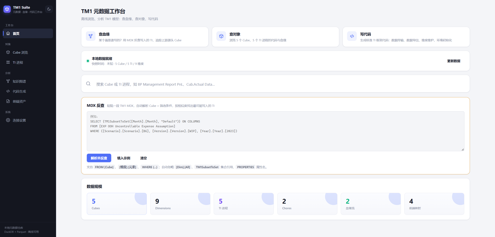

**Cube 浏览**——维度结构单行展示、数据流向图（源头 Cube → 搬运 TI → 本 Cube）、逐写入点拆解：

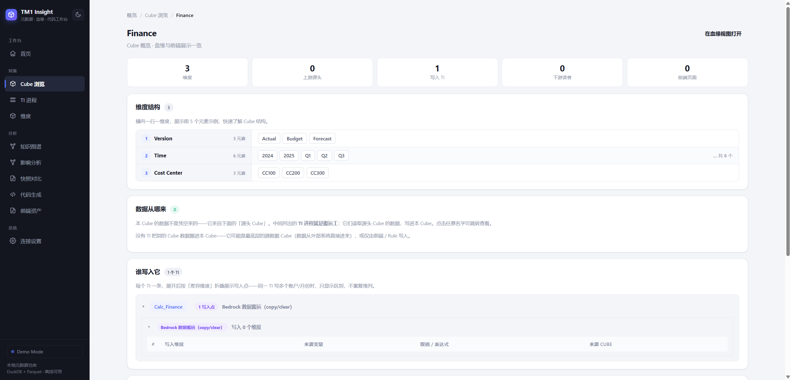

**维度浏览**——维度层级结构、元素与别名，快速理解模型维度的组织方式：

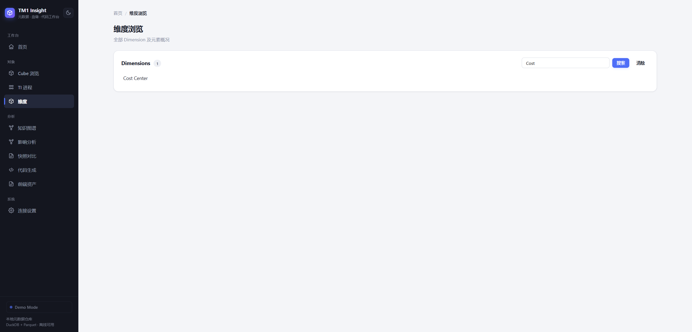

**TI 进程**——参数/变量/Prolog/Metadata/Data/Epilog 分 Tab 浏览，代码高亮 + 行号，右侧栏跨 Tab 搜索代码、数据源头与调用关系：

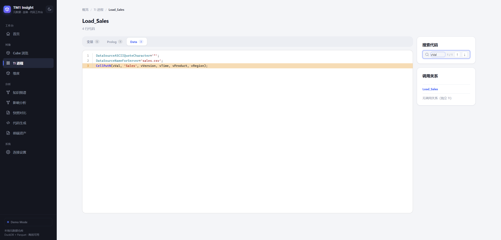

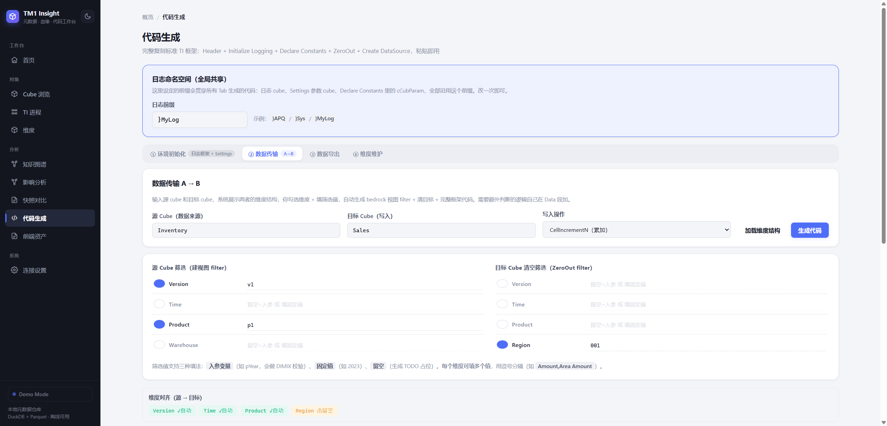

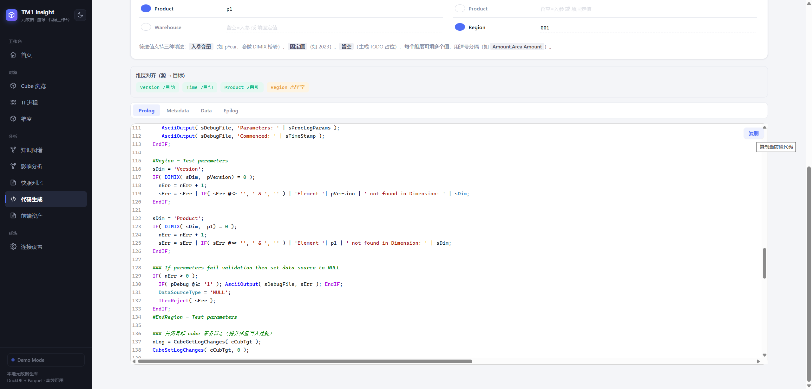

**知识图谱**——以 TI 为中心，看它往哪个 Cube 的哪个切面写数据：每个写入点的维度、来源变量、取值与写入前提：

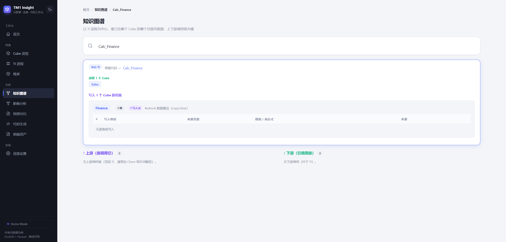

**影响分析**——选择任意对象（维度 / Cube / TI），递归追踪下游影响面，按依赖深度分层展示传播路径：

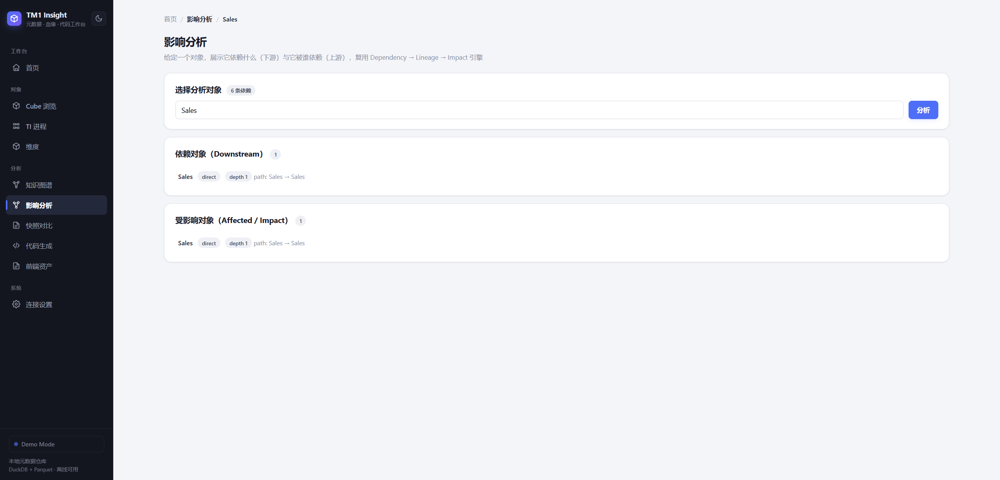

**快照对比**——对象级 diff + 变更情报，自动定位"哪些地方变了"，聚焦变更点而非全量 diff：

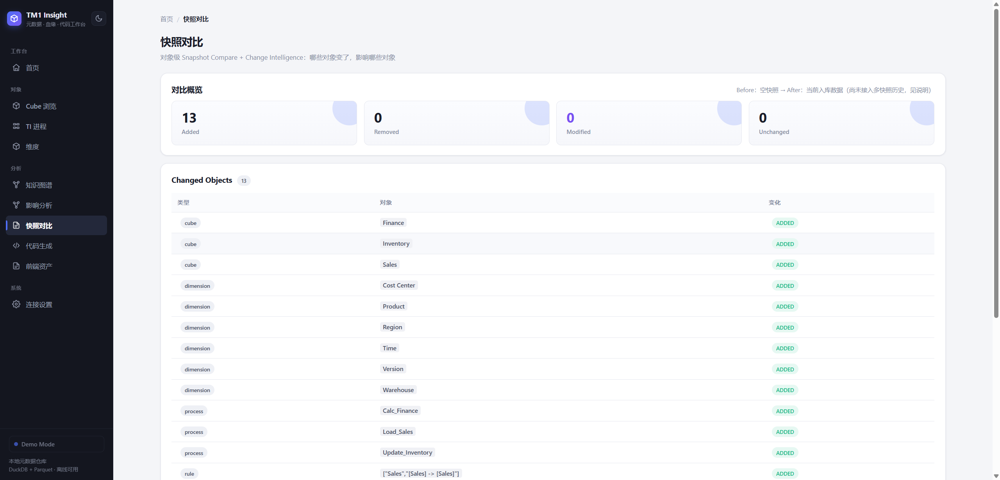

**前端资产**——扫描前端 Excel，自动建立"前端页面 → 后端 Cube"映射，标出含 TM1 公式与断链风险：

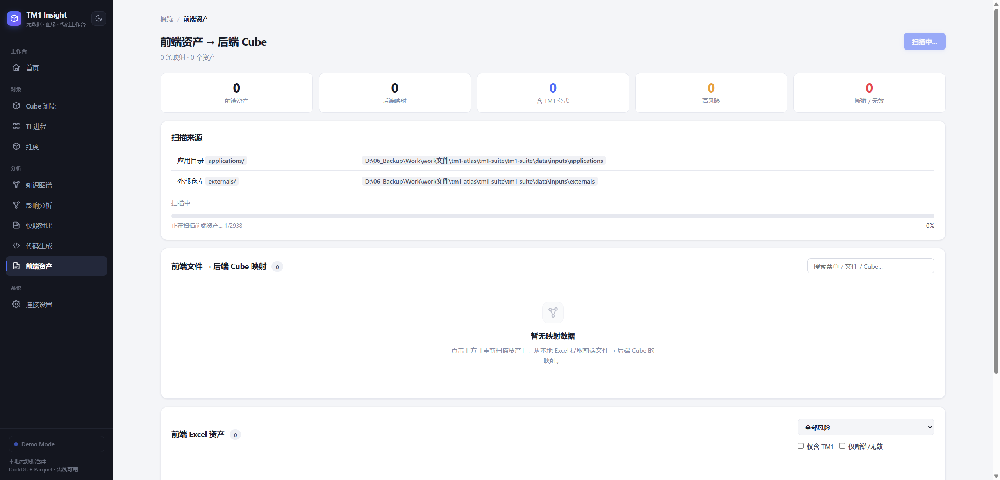

**连接设置**——配置 TM1 连接、一键拉取元数据、数据源管理与数据包导入：

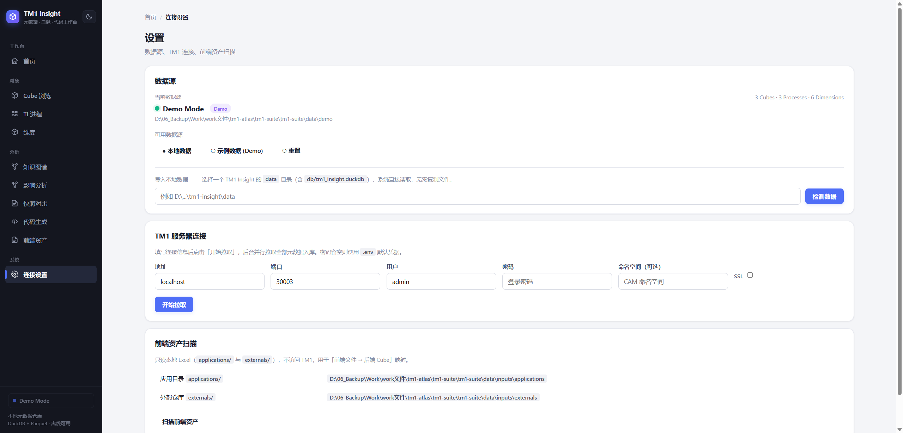

---

## 快速开始

### 前置条件

- **方式 A（便携版 exe）**：无需任何前置条件，Windows 直接双击即用
- **方式 B/C（源码）**：需要 Python **3.9+**（推荐 3.11）
- 能连 TM1 的网络（**仅拉取真实数据时需要**；看演示数据、离线浏览都不需要）

---

### 方式 A · 便携版 exe（免安装，双击即用，强烈推荐）

下载 `TM1 Insight` 便携目录（GitHub Releases 的 zip），解压后双击 `TM1 Insight.exe`：

1. 首次打开自动进入 **Demo 模式**（无需连 TM1、无需装 Python、无需装任何依赖）
2. 自动打开浏览器 `http://127.0.0.1:8000`（端口被占用时自动递增）
3. 数据保存在 `%LOCALAPPDATA%\TM1 Insight\`，升级替换文件夹不丢数据
4. 可在「设置 / 数据源管理」上传 `.duckdb` / `.zip` 数据包切换真实数据

> **适合人群**：只想看效果、不想折腾环境的用户。便携目录内含 Python 运行时 + 全部依赖，真正的零安装。

---

### 方式 B · Windows 一键启动（源码，零配置看效果）

直接双击项目根目录的 **`start.bat`**，它会自动完成：

1. 检查并安装依赖（首次约 2-5 分钟，自动镜像加速 + 失败回退）
2. 启动 Web UI 并自动打开浏览器 `http://localhost:8000`
3. **本地没有数据时，自动进入 Demo 模式**（无需连 TM1）

> **演示数据 vs 真实数据**：Demo 模式是一套虚构的「销售 → 成本 → 利润」模型，
> 用于让你先看完整界面和功能长什么样。要看你自己 TM1 环境的真实数据，请按下方
> 「方式 C」配置连接后运行 `tm1-insight ingest`。

---

### 方式 C · 命令行安装（拉真实数据）

```bash
git clone https://github.com/realYurk/tm1-insight.git
cd tm1-insight

# 安装依赖 + 以可编辑模式安装本包
pip install -e .
```

> 内网环境可用阿里云镜像加速：
> `pip install -r requirements.txt -i http://mirrors.aliyun.com/pypi/simple --trusted-host mirrors.aliyun.com`

#### 配置连接（首次拉数据）

```bash
cp .env.example .env
```

用编辑器打开 `.env`，填入你的 TM1 服务器信息：

```ini
TM1_ADDRESS=你的服务器地址
TM1_PORT=30003
TM1_USER=你的用户名
TM1_PASSWORD=你的密码
TM1_SSL=false
TM1_NAMESPACE=你的命名空间（可选）
```

测试连通：

```bash
tm1-insight check
```

看到"连接成功"和对象数量，就说明连上了。

#### 拉取数据 + 启动

```bash
# 拉取全部元数据并入库（首次约 10-20 分钟）
tm1-insight ingest

# 启动 Web UI
tm1-insight web
```

浏览器打开 **http://localhost:8000** 即可。

---

### 方式 D · Docker

```bash
docker compose up -d
# 首次需手动入库：
docker compose run --rm tm1-insight ingest
```

---

## 使用手册

### 首页（`/`）

- **全局搜索**：输入 Cube / TI 进程 / Chore 名字，实时联想，回车直达详情页。
- **三个任务入口**：查血缘（MDX 反查）、查对象（浏览 Cube/TI）、写代码（代码生成）。
- **MDX 反查**：粘贴一段 MDX，自动找出"最可能写入这个交叉点的 TI"。
- **数据规模**：一眼看清库里的 Cube / 维度 / TI / Chore / 血缘流 / 前端映射数量。

### Cube 浏览（`/cubes`）

全部 Cube 列表，支持搜索、分页。点进任意 Cube 详情页，能看到：

- **维度结构**：每个维度一行，右侧展示元素示例。
- **数据从哪来**：数据流向图 —— 源头 Cube → 搬运 TI → 本 Cube。
- **谁写入它**：每个写入 TI 按"差异维度"折叠，看清写入点、来源变量、写入前提。
- **谁读它**：下游读取该 Cube 的 TI 列表。
- **前端展示**：该 Cube 是否在某个前端 Excel 页面直接呈现。
- **规则**：Cube 的 Rule 代码，语法高亮。

### TI 进程（`/processes`）

全部 TI 进程 + Chore 列表。点进 TI 详情页：

- **参数 / 变量 / Prolog / Metadata / Data / Epilog** 分 Tab 浏览，代码语法高亮 + 行号。
- **代码搜索**：右侧栏搜索关键字，跨所有 Tab 定位，↑↓ 切换命中。
- **数据源头**：该 TI 读取 / 写入的 Cube。
- **调用关系**：谁调用它、它调用谁（递归树）。

### 知识图谱（`/graph`）

输入一个 TI 进程名，以它为中心展示：

- **写入切面**：它往哪个 Cube 的哪个切面写数据（维度、来源变量、取值、写入前提）。
- **上游 / 下游调用链**：递归展开，点击任意节点可"以此为心"重新聚焦。

### 代码生成（`/codegen`）

生成标准 TI 框架代码，包括：

- **数据传输**：Cube A → Cube B，自动补全变量、维度映射、CellGet/CellPut。
- **数据导出**：Cube 导出 / 维度导出（CSV / 文本）。
- **维度维护**：增删维度元素。
- **环境初始化**：`}APQ Settings` 等参数 Cube 的初始化代码。

生成的是 **Cubewise APLIQODE 框架**风格的标准代码，可直接复制到 TM1 使用。

### 影响分析（`/impact`）

选择任意对象（维度 / Cube / TI 进程），递归追踪它的下游影响面：

- **影响范围**：改了这个对象，会波及哪些 Cube、TI、Chore，按依赖深度分层展示。
- **传播路径**：从源头到每个受影响对象的完整链路。

### 健康巡检（`/health`）

对模型做自动化体检，输出风险清单：

- **断链检测**：引用了不存在的 Cube / 维度 / TI。
- **循环依赖**：TI 调用链成环。
- **空 / 未使用对象**：无数据的 Cube、从未被调用的 TI。
- **规则风险**：Rule 引用缺失、Feeders 缺失等。

### 模型对比（`/compare`）

对比两个模型快照或两次拉取的差异：

- **对象级 diff**：新增 / 删除 / 修改的 Cube、维度、TI、Chore。
- **变更情报**：自动定位"哪些地方变了"，聚焦变更点，而非全量 diff。

### 前端资产（`/audit`）

扫描本地前端 Excel（`applications/` 与 `externals/` 目录），产出：

- **统计卡片**：资产数、映射数、含 TM1 公式数、高风险 / 断链数。
- **前端 → 后端映射表**：每个菜单/文件对应哪些后端 Cube。
- **资产风险表**：按风险等级 / 是否含 TM1 / 是否断链筛选。

### 数据源管理（`/settings`）

统一管理"数据从哪来"，本地数据优先、Demo 兜底：

- **数据源指示器**：侧边栏实时显示当前数据源（Local TM1 Data / Demo Mode）。
- **导入数据包**：上传 `.duckdb` 或 `.zip` 数据包，一键切换本地数据。
- **选择本地目录**：指向已有 `data/` 目录（含 `db/tm1_insight.duckdb`）。
- **Demo 模式**：无任何本地数据时自动生成内置小型模型，保证首开即有内容。
- **TM1 连接配置**：连接 TM1 Server、重新拉取元数据、重新扫描前端资产。

---

## CLI 命令速查

```bash
tm1-insight status            # 查看各表行数与数据库路径（离线可用）
tm1-insight query "<Cube名>"  # 查某个 Cube 的读写者 + 维度（离线可用）
tm1-insight audit             # 重扫前端 Excel 资产（离线可用）
tm1-insight ingest            # 拉取 + 入库（需要连 TM1）
tm1-insight ingest --no-export  # 不重新拉取，仅用已有 raw 数据入库
tm1-insight check             # 测试 TM1 连接
tm1-insight web               # 启动 Web UI（--no-browser 不自动开浏览器）
```

---

## 新机器快速部署

**场景 A：已有数据包（最常见）**

同事把整个项目目录（含 `data/`）打包给你：

```bash
# 1. 解压到任意目录，进入
cd tm1-insight

# 2. 装依赖
pip install -e .

# 3. 直接启动（无需连 TM1）
tm1-insight web
```

**场景 B：纯程序，自己连 TM1 拉数据**

```bash
git clone https://github.com/realYurk/tm1-insight.git
cd tm1-insight
pip install -e .
cp .env.example .env   # 填真实连接信息
tm1-insight check        # 测连通
tm1-insight ingest       # 拉数据
tm1-insight web          # 启动
```

> 说明：以上两种场景也可以用 `start.bat` 替代，它会在无数据时自动生成演示数据，
> 有 `data/` 时直接启动。

---

## 项目结构

```
tm1-insight/
├── src/tm1_insight/
│   ├── api/                 # FastAPI Web UI（路由 + Jinja2 模板 + 静态资源）
│   ├── cli.py               # CLI 入口（typer）
│   ├── config.py            # 配置（.env 加载 + 数据目录覆盖）
│   ├── datasource.py        # 数据源管理（本地 / Demo / TM1 Server / 空）
│   ├── portable.py          # 便携版运行时（端口探测 + 自动开浏览器）
│   ├── ingest/              # 数据抽取（exporter/loader/audit）
│   ├── store/               # DuckDB 存储 + 查询 + 代码生成
│   ├── lineage/             # 语句级血缘引擎
│   ├── impact/              # 影响分析引擎
│   ├── health/              # 健康巡检引擎
│   ├── compare/             # 模型对比引擎
│   ├── change_intelligence/ # 变更情报引擎
│   ├── dependency/          # 依赖图引擎
│   ├── analysis/            # 通用分析
│   └── tm1/                 # TM1py 客户端封装
├── data/                    # 本地数据仓库（不入库，见 .gitignore）
├── start.bat                # Windows 一键启动（源码模式）
├── launcher.py              # 便携版 exe 启动入口
├── build_portable.bat       # 便携版打包脚本（生成 TM1 Insight.exe）
├── tm1_insight.spec           # PyInstaller 打包配置
├── make_release.py          # 打包脚本（程序体 / 数据体分离）
├── Dockerfile / docker-compose.yml
├── requirements.txt / pyproject.toml
└── README.md
```

---

## 打包分发

### 便携版（exe，Windows 免安装）

新电脑**无需安装 Python**，解压双击 `TM1 Insight.exe` 即可使用：

```bash
build_portable.bat          # 生成 release\TM1 Insight\ 便携目录
```

- **产物**：`release\TM1 Insight\TM1 Insight.exe`（PyInstaller onedir）。
- **软件与数据分离**：程序文件放解压目录，数据（配置 + 模型数据 + 日志）放 `%LOCALAPPDATA%\TM1 Insight\`，升级替换文件夹不丢数据。
- **端口自动递增**：8000 被占用时自动改用 8001、8002…… 并自动开浏览器。
- **导入数据包**：首次打开进入 Demo 模式，可在「设置」里上传 `.duckdb` / `.zip` 数据包或选择本地 `data/` 目录切换真实数据。

详见便携版说明 `PORTABLE_README.txt`（打包时复制为 release 内的 `README.txt`）。

### 程序体 / 数据体分离（源码分发）

项目内置 `make_release.py`，把发布拆成"程序体"和"数据体"：

```bash
python make_release.py                # 程序体 + 数据体
python make_release.py --app-only     # 只打程序体（源码，更新低频）
python make_release.py --data-only    # 只打数据体（duckdb + inputs，随 TM1 更新）
```

- **新用户**：解压程序体 + 数据体到同一目录，双击 `start.bat` 即可。
- **更新数据**：只替换数据体（解压覆盖 `data/`），程序体不动。
- **更新程序**：只替换程序体，数据体不动。

---

## 常见问题

**Q：离线能用吗？**
A：能。只要本地有 `data/`（之前拉过数据，或 start.bat 自动生成的演示数据），
所有分析都在本地跑，不连 TM1。

**Q：双击 start.bat 提示「依赖安装失败」怎么办？**
A：常见原因与对策：

| 现象 | 原因 | 对策 |
|---|---|---|
| 一直卡在安装 | 首次装依赖需 2-5 分钟 | 耐心等待，别关窗口 |
| 报超时/连接失败 | 内网无法访问阿里云镜像 | 脚本已自动回退清华镜像；仍失败则手动 `pip install -r requirements.txt -i https://pypi.org/simple` |
| 报「No module named tm1py」 | 依赖没装全（网络中断） | 打开命令行，进目录后跑 `pip install -r requirements.txt` 看真实报错 |
| Python 未找到 | 没装 Python 或没勾 Add to PATH | 装 Python 3.9+ 并勾选「Add to PATH」 |

**Q：打开页面是空的？**
A：说明本地还没有数据。直接双击 `start.bat` 会自动生成一套演示数据；
要看真实数据则需配置 `.env` 连接 TM1 后运行 `tm1-insight ingest`。

**Q：新电脑没有数据，打开是空壳吗？**
A：不会。首次启动若检测不到本地数据，会自动进入 **Demo 模式**，加载内置小型模型，让你先看到完整能力；之后可导入真实数据包切换。

**Q：怎么导入别人打包的数据包？**
A：在「设置 / 数据源管理」上传 `.duckdb` 文件或 `.zip` 数据包，或选择本地 `data/` 目录（含 `db/tm1_insight.duckdb`），一键切换。

**Q：`tm1-insight` 命令找不到？**
A：确认 `pip install -e .` 成功；或改用 `python -m tm1_insight.cli <命令>`。

**Q：Windows 上不想装 Python？**
A：直接用便携版 `TM1 Insight.exe`，解压双击即可，无需任何开发环境。

**Q：Chore 步骤为空？**
A：Chore 步骤数据需在拉取元数据时展开。重新 `tm1-insight ingest` 即可填充。

**Q：怎么更新数据？**
A：连上 TM1 后重新 `tm1-insight ingest`；或直接替换别人打包好的 `data/` 目录。

---

## 免责声明

- **本项目是独立的第三方工具**，与 IBM 无任何隶属、授权或背书关系。
- **TM1 / IBM Planning Analytics 是 IBM 的商标**，本项目仅作为其生态的辅助工具使用。
- 本软件按"现状"提供，作者不对因使用本软件造成的任何损失承担责任。
- 使用前请确保你有权访问所连接的 TM1 服务器及数据。
- 详细授权条款见 [LICENSE](LICENSE)。
