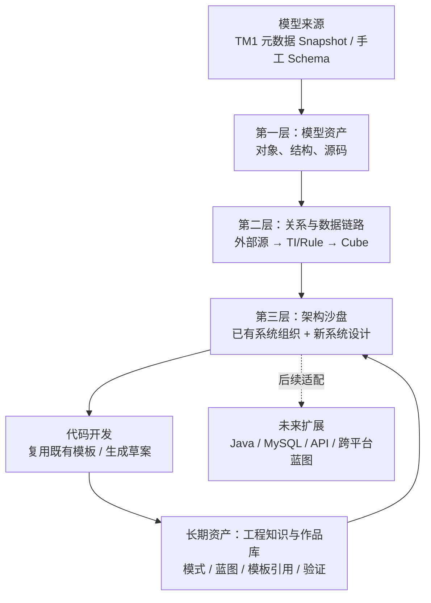

# TM1 Insight 未来产品需求说明书

> **版本**：v1.0 · 产品愿景与需求确认稿  
> **文档状态**：讨论中 / 尚未批准开发  
> **编写日期**：2026-10-21  
> **定位**：面向个人的企业计算系统架构理解、可视化设计、工程知识与开发资产平台  
> **主要依据**：用户《问题点盘点.md》、近期对 TM1 Insight 的产品讨论与既有设计原则  
> **重要声明**：本文件用于**逐项核对产品设想**，不是开发任务书，不代表所有功能已经实现；尤其不要直接作为一次性 Codex 开发指令。

---

## 阅读与确认说明

本说明书刻意区分四类信息，以避免把产品建议误写成用户已经决定的需求：

| 标记 | 含义 | 处理原则 |
|---|---|---|
| **【已明确】** | 用户已经反复表达或明确确认的原则/目标 | 默认保留，修改需单独确认 |
| **【用户设想】** | 用户希望实现，但具体交互、算法和边界尚待确定 | 先核对需求，后定实现 |
| **【产品建议】** | 为了可交付性、可信度或体验提出的实现建议 | 用户可以同意、修改或删除 |
| **【待决策】** | 存在明显的不同方案或信息缺口 | 不得擅自视为定稿 |

**需求状态说明**：`已有基础`仅表示在此前开发和讨论中出现过相关功能，**并非本次代码审计结果**；`待核实`代表需核查当前仓库、UI、数据结构及测试后才能确定；`新增`代表未来能力；`优化`代表对既有功能的改造。

**逐项核对方式**：每一项主要需求均有编号（例如 `FR-ARC-03`）。可将末尾「需求确认清单」中的 `[ ]` 改为 `[x]`，或写成「同意 / 修改 / 暂缓 / 删除」，再进入开发方案阶段。

---

# 第一部分：产品定位与基本原则

## 1. 产品背景：为什么要调整方向

### 1.1 过去的出发点

TM1 Insight 最初希望突破传统 TM1 工具限制，弥补远程 Architect/部分 Arc 编辑和分析体验的不足，并对大型 TM1 模型进行离线读取、源码检索、对象依赖、血缘及架构分析。

在已有研发过程中，模型浏览、Process/Rule 解析、依赖、数据血缘、业务架构、Mermaid、AI 分析包和代码开发模板等能力逐渐形成。但是用户在真实使用时发现：

1. **功能分散**：想调查某个 Cube 和某个 MDX 切面时，需要反复切换多个页面，思考上下文经常丢失。
2. **分析多、开发少**：能列出大量对象关系、证据和流程图，却不能自然衔接到新功能设计和实施。
3. **技术事实不等于可复用经验**：旧模型中的大量 Cube、TI 和 Rule 本身不是高质量个人知识资产。
4. **旧实现不一定是最佳设计**：完整逆向一个分摊模块，并不意味着应该原样复制到新项目。
5. **个人目标更宽**：用户希望提高的是**新功能设计与开发能力**，不是把主要能力定位为故障排查或遗留系统运维。

### 1.2 本次调整的中心思想【已明确】

> **以已有系统为参考和知识输入，以可视化架构沙盘为连续工作界面，以既有代码开发模板为执行出口，以可携带的知识/作品/设计资产为长期积累。**

产品价值不能停在“解释旧系统”，而要进一步实现：

- **Understand**：快速理解陌生模型和已有数据链路。
- **Design**：根据具体公司数据结构，设计新 Cube、处理链路和业务模块。
- **Build**：使用现有模板将设计转成 TI、Rule、对象创建方案等开发成果。
- **Reuse**：把经过人工提炼和验证的模式、蓝图、模板、测试重新用于下一个项目。

这是四个连续动作，**不是四套相互隔离的软件**。

## 2. 目标用户、首要目标和非目标

### 2.1 首要用户【已明确】

现阶段**唯一确定的目标用户是产品作者本人**。首要评判标准：是否真正帮助个人开发新的 TM1/企业计算功能、沉淀能够带走且有合法复用权的能力资产。

未来可以延伸到：接手陌生 TM1 系统的开发者、企业模型架构师、咨询与交付人员，但**本版暂不以迎合广泛客户为优先**。

### 2.2 长期能力路线【已明确】

采用 **C 路线**：

> 掌握技术无关的企业计算系统设计方法，并能分别在 **TM1** 与 **Java/Python** 等平台上实现。

近期以 TM1 为切入点；跨平台设计表示先行，跨平台完整自动生成与部署循序验证。

### 2.3 核心成功标准【产品建议】

- 接触一个陌生、经过授权的 TM1 模型后，快速盘点结构并聚焦一条真实业务线。
- 从一个 CSV/外部 Schema 及业务需求出发，设计多维模型并复用模板形成可审查的代码草案。
- 对一个新需求，使用软件**比单纯 ARC + 自己画图 + 外部 AI**更连续、更少重复劳动。
- 新增功能交付后，能方便地保留其设计、模板使用记录及验证结果；下一次项目可检索并复用。
- 个人资产与客户/企业专有模型严格分离，支持合法导出和迁移。

### 2.4 当前明确不追求【已明确 / 产品建议】

- 不做 TM1 Server 的实时数据分析、财务数据查看器或在线监控中心。
- 不把线上修改 TM1 Cube、执行 TI、实时取数作为核心业务。
- **产品本体不内置 AI 模型、对话或云端 AI API**；可导出受控材料供用户自行选择外部 AI。
- 不重造用户已经满意的**代码开发/模板模块**。
- 不把“完整复刻旧企业分摊系统”作为新模块的前提。
- 不把全面替代 Arc/Pulse 的 DevOps、监控和迁移功能作为当前目标。
- 不在第一阶段扩张成通用 Java 逆向器、任意微服务生成平台或无约束低代码产品。

## 3. 第零号原则：仅元数据、离线优先、安全隔离【已明确】

### 3.1 服务器访问边界

**允许**：由用户主动发起的一次性模型定义采集，读取必要的 TM1 对象结构和源码，例如 Cube 元数据、Dimension/Hierarchy、元素类型及权重、TI 源码与参数、Rule/Feeder 源码、Chore 定义等。

**禁止**：

1. 从业务 Cube 中读取单元格数值、财务数据或客户数据。
2. 以 MDX/Cellset 等方式查询 Cube 业务数据。
3. 为了分析而执行生产 TI、Chore 或服务器侧修改操作。
4. 后台持续连接/监听生产服务器。
5. 未经授权自动访问 CSV 内容、SQL 业务表、HTTP 业务接口。
6. 自动向外部 AI 上传代码、Snapshot 或其他可能敏感的企业资料。

> **边界提醒**：Dimension 成员、元素属性、TI/Rule 字面量和连接配置也可能含敏感信息。它们属于模型资料，不等于天然无敏感性；采集字段应最小化、凭据应脱敏或不落盘。

### 3.2 连接工作流【已明确】

`用户发起连接 → Python TM1 REST API 只读采集 → 形成本地 Snapshot → 结束会话 → 后续本地离线分析`

- 采集是**有限时长、用户可见、用户可停止**的任务，不维持永久在线会话。
- 采集结果不能混入软件安装目录，应保存在独立用户数据目录。
- 开发测试期间，禁止 Codex/软件未经授权访问任何真实企业服务器；只使用已有本地快照及合成测试模型。
- 需要实际连接测试时，必须另行获得明确授权并使用允许的隔离环境。本文件**不授权**任何真实连接或扫描。

### 3.3 Portable 与软件数据分离【已明确】

- Windows Portable，目标为复制即用，不需要用户安装 Python、Node、Git 或管理员权限。
- 代码、安装包、运行时组件与用户模型、DuckDB、Snapshot、知识/作品资产完全分离。
- 软件发布包不得包含企业模型、数据库、样本客户数据或凭据。
- 软件版本升级、应用重装不应清空用户个人资产及模型历史。
- 所有原始 Snapshot 默认只读；个人标注/设计稿存入独立工作区。

---

# 第二部分：整体产品架构与导航设计

## 4. 建议的产品结构

### 4.1 逻辑能力层（不等于左侧菜单层数）



### 4.2 推荐的一级入口【产品建议，待确认】

1. **模型资产**：查看已有 Cube、Dimension、TI/Process、Rule、Chore、数据源与结构。
2. **架构沙盘**：查看/追踪业务数据链路，组织已有模块，可切换到新的设计草稿。
3. **代码开发**：保留当前满意的模板与代码生成体验，只增强与沙盘的数据联动。
4. **工程资产**：保存个人可复用的设计知识、作品、验证成果及模板引用。
5. **模型管理**：连接配置、本地 Snapshot、导入导出、安全/诊断等次级功能，可收纳到设置/管理区。

**设计原则**：数据血缘、业务架构、影响查询等底层能力可以存在，但应成为同一架构沙盘的**视图/操作**，而非迫使用户频繁跳转的主页面。

### 4.3 用户的两条主工作路线【用户设想】

**路线 A：已有系统 → 新功能开发**

`采集模型 → 查询对象/源头 → 展开业务链路 → 人工组建业务模块 → 参考已有设计 → 创建新 Cube/关系草稿 → 关联模板 → 生成代码与验收说明`

**路线 B：新项目 → 快速交付**

`导入客户授权的 Schema/CSV 表头 → 人工/外部 AI 设计模型 → 在沙盘配置 Cube、维度和处理链 → 选择成熟业务组件 → 生成技术实现 → 测试 → 沉淀可复用蓝图`

两条路线应共用：**画布、模型契约、代码模板、资产管理机制**。

---

# 第三部分：第一层——模型资产（认识系统）

## 5. 对象目录与查看

### FR-MDL-01 统一对象浏览【已明确｜已有基础，待核实】

- 支持浏览 Cube、Dimension、Hierarchy、Process/TI、Rule、Chore。
- 支持名称搜索、前缀筛选、对象类型筛选、自然排序及快速定位。
- Cube 页面显示维度顺序、主要引用、关键 Rule、可确认的写入点。
- Dimension 页面显示层级、元素/成员类型、汇总权重等**已获授权的结构元数据**。
- TI 页面显示分段源码（Prolog、Metadata、Data、Epilog）、参数和数据源声明。
- Rule 页面首先显示可阅读的原始 Rule/Feeder 源码；技术 IR 按需展开。
- Chore 页面显示定义和可确认的静态任务引用，不夸大真实运行时序。

### FR-MDL-02 模型快速体检【用户设想｜优化/新增】

新导入一个 Snapshot 后，形成**结构资产盘点**：

- Cube、维度、Process、Rule、Chore 数量和主要结构特征。
- 主要外部数据源类别（CSV、ODBC/SQL 等——仅限可确认声明）。
- 关键或高连接度对象、名称前缀与技术辅助对象。
- 源码/关系可解析范围与不确定性摘要。
- 可手动选择的“开始探索”入口。

**禁止**把“模型体检”理解为读取 Cube 财务数值、计算指标或扫描客户记录。

### FR-MDL-03 保持操作上下文【已明确｜高优先级优化】

用户在查看某个 Cube、Rule、TI、Dimension 时：

- 不离开当前调查/设计工作区，优先用右侧详情卡、可调整抽屉或分屏预览。
- 保留当前选择的 Cube、MDX **文本或维度切面描述**、筛选条件、图形布局、展开层级及滚动/聚焦位置。
- 支持返回上一步、浏览历史、对象定位与详情关闭。
- **MDX 文本只用于表达用户关注的切面，不在产品中向 TM1 Server 执行取数**。

**关键验收场景**：正在研究 A Cube 的某个 MDX 切面时，点开关联 TI，再展开其 Rule，返回后仍停留在同一业务链和当前切面。

---

# 第四部分：第二层——数据来源、血缘与关系可视化

## 6. 默认要回答的问题

用户希望直观看到：

> **原始数据来自哪里？通过哪些 TI 或 Rule 参与处理？到达了哪些 Cube？具体涉及哪些固定或动态切面？再往下游是什么？**

但源/目标切面尚未解析完整时，产品必须显示“未知”，不能仅凭对象共现推断值传输。

## 7. 外部数据源链路

### FR-LIN-01 外部数据源节点【用户设想｜新增】

支持在关系图中展示**源码已声明或用户手动定义**的：

- CSV / TXT / 文件源；
- ODBC、SQL 查询或数据库源的**引用**；
- 后续扩展 HTTP API 等外部接口的**设计节点**。

典型期望：

`GeneralLedger.csv → LoadGL TI → General Ledger Cube → Transfer TI → Cost Cube`

**边界**：现有 Snapshot 若仅记录文件路径或 SQL 字符串而没有列元数据，只能显示数据源存在；**不能臆造列结构**。

### FR-LIN-02 Schema/字段结构查看【用户设想｜新增】

点击外部数据源时，可显示：

- 已声明的字段名、列序、类型、示例说明（如果确实存在）；
- 元数据来源：源码、用户输入、Schema 文件、未知；
- 展开/折叠字段详情，避免在主画布显示过多列。

允许用户**主动导入不含业务行数据的 Schema 描述、DDL 或 CSV 表头**，并将其与数据源引用关联。不得擅自打开外部客户文件、读取业务数据行或查询数据库。

### FR-LIN-03 从中间对象追到外部源【用户设想｜新增/优化】

- 从 General Ledger Cube 或任意对象出发，追踪**已证实/候选**的上游路径。
- 追踪到明确的 CSV/SQL/外部 Schema 节点时可停下；用户也可选择指定深度或边界。
- 遇到动态文件名、变量源、不完整 Snapshot 时应停在“未确认来源”占位节点，而不是补全臆测路径。
- 可从外部源往下游持续展开，形成一条可阅读的业务数据线。

## 8. 关系图主视图

### FR-LIN-04 Cube 优先、TI/Rule 作为处理关系【已明确｜优化】

- 主视图突出 Cube（及外部源），不要默认把每一条技术调用都渲染成显眼节点。
- Cube 之间经 TI 形成的**关联展示**，应能展开具体 TI 读/写事实；没有精确值绑定则必须保持对象级关系描述。
- Rule 以**声明式计算引用**的边/节点区分于 TI 的物理写入。
- Feeder 另有技术关系，不当成数值流向。
- 同一对 Cube 之间若有多个 TI/Rule，默认聚合显示数量，点击才展开。
- 必须支持 `Cube → TI → 同一个 Cube` 之类的自读自写/自环关系。

### FR-LIN-05 切面卡片（Slice Card）【已明确｜优化】

点击一条关系，在不跳页的情况下展示：

| 项目 | 展示要求 |
|---|---|
| 关联类型 | TI 读取、TI 写入、Rule DB 引用、Call 等 |
| 相关程序 | TI 名称，Rule 所属 Cube 与行号 |
| 读取侧 | 源对象、View/Subset/可确认源切面 |
| 写入侧 | 目标 Cube、`CellPutN`/`CellIncrementN` 等语义 |
| 固定成员 | 按维度明确展示已确认的固定值 |
| 动态成员 | 变量、参数、表达式，不伪造实际取值 |
| 条件约束 | 可解析的 IF、过滤或上下文 |
| 限制与证据 | 源码位置、缺失字段绑定、范围与运行验证状态 |

- 源码表达式支持语法高亮、行号、复制、跳转到相关行。
- 对未绑定的 `vValue` 等变量，显示“源值绑定未确认”；不可直接画成确定性逐单元格传输。
- Rule 的 LHS 目标区域不完整时，保留不确定状态，不用伪造精确坐标。

### FR-LIN-06 图下方统一关系表【用户设想｜新增/优化】

保留一组可切换 Tab：

1. **数据处理**：来源、处理 TI、目标、读/写方式、主要切面。
2. **Rule 关系**：所属 Cube、目标区域摘要、DB 来源、表达式位置。
3. **上游引用**：谁为当前对象提供数据或参与计算。
4. **下游引用**：谁读取/引用当前对象。
5. **调用关系**：Caller、被调用 Process、条件与未证实运行序列。
6. **外部源**：CSV/SQL 引用、Schema 状态。
7. **技术证据**：原文、解析限制、诊断（默认折叠）。

图和表**共享当前筛选与选中对象**；选择表格一行会高亮对应图关系，反之亦然。

## 9. 图查询与筛选

### FR-LIN-07 单对象探索【用户设想｜新增/优化】

输入一个 Cube，指定：上游/下游/双向、最大深度、对象类型、关系类型。局部展开、局部折叠，避免一次显示整套企业模型。

### FR-LIN-08 两组对象之间的路径查询【用户设想｜新增】

例如：

- 来源集合：名称前缀 `SC*` 的 Cube；
- 目标集合：名称前缀 `BP*` 的 Cube；
- 只展示两组之间**存在分析证据**的路径及必需中间对象。

查询结果按发现路径数量、深度和对象范围进行预算与分页，不允许仅根据命名前缀构造虚假关系。

### FR-LIN-09 人工选择局部模型【用户设想｜新增】

用户选定 10 个 Cube，显示它们之间已确认/候选关系，允许补充关联对象；手动选中与智能扩展属于同一张画布，不重复设计两套功能。

### FR-LIN-10 降噪和可读性【已明确｜优化】

- 开关：隐藏 `}` 开头的技术系统对象。
- 开关：折叠/隐藏 Bedrock 和日志等辅助 TI。
- 按对象类型、前缀、关系类型、证据级别筛选。
- 默认显示人能理解的“来源、处理、输出”，繁杂状态枚举进入详情。
- 图布局支持自适应、节点上限、缩放、焦点模式和关系聚合。

### FR-LIN-11 影响范围概览【用户设想｜新增/优化】

例如输入 `SC`，列出相关业务对象、关联模块及直接/间接路径，支持表格+局部图。

**边界**：名称前缀不是业务模块归属证明。影响范围只代表结构/源码层面的潜在关联，不等于运行时必然影响；实际业务影响还需条件、切面、调用证据。

---

# 第五部分：第三层——架构沙盘与可视化开发（产品核心）

## 10. 设计目标

### 10.1 核心画面【已明确】

希望形成类似“游戏地图/编队/指挥官工作台”的直观操作感，但借鉴的是：**拖动、框选、编组、聚焦、分层、展开、折叠、局部操作**，而不是追求华丽 3D 效果。

**一张画布既能组织已有架构，也能承载新建模型设计；两种模式共享视觉和数据契约。**

### 10.2 两种模式【产品建议，待确认】

| 模式 | 目标 | 允许行为 | 禁止行为 |
|---|---|---|---|
| **探索模式** | 看清已有系统、提取参考实现 | 搜索、筛选、展开关系、分组、注释、保存视图 | 修改原始 Snapshot 或服务器 |
| **设计模式** | 搭建未来模型和处理链 | 新建草稿对象、连线、配置映射、关联模板、生成草案 | 未经审批自动部署到生产服务器 |

**特别强调**：已有真实对象、用户人工描述与尚未创建的草稿对象，必须在图形和数据上清晰区分。

## 11. 架构画布交互需求

### FR-ARC-01 连续工作空间【已明确｜最高优先级】

- 左侧：对象和模块资源列表。
- 中间：可拖拽关系画布。
- 右侧：选中节点/边的详情与配置。
- 底部：可折叠表格、源码、证据、设计笔记。
- 一个工作区内完成：查看 → 分析 → 设计 → 关联模板，不靠多页面跳转。
- 保留当前图状态、焦点、筛选、MDX 文本与工作进度。

### FR-ARC-02 图层次与展开策略【用户设想｜新增】

支持三个视图层次：

1. **系统/模块总览**：费用、经营计划、分摊、总账等抽象模块。
2. **模型关系**：Cube、TI、Rule、外部源、Dimension/Schema。
3. **处理细节**：字段映射、切面、Rule 表达式、源码证据。

逐级展开，避免在总览图把所有技术细节摊开。

### FR-ARC-03 编队式模块分组【用户设想｜新增】

- 框选多个 Cube、TI、Rule、外部源或关系，创建“分摊模块”“费用模块”等自定义组。
- 组可折叠、移动、命名、备注、选择颜色、保存布局。
- 多个组可组合为上层模块，例如经营计划、费用控制。
- **同一对象可以同时出现于多个逻辑模块**，不得更改真实模型所属关系。
- 支持手工调整系统建议的分组；人工确认与自动推断分开保存。
- 模块卡片可附“业务目标、输入、输出、关键组件、可借鉴模式”等说明。

### FR-ARC-04 工作区保存与恢复【已明确｜新增/优化】

可保存：Snapshot/版本引用、所选对象、图布局、过滤条件、模块分组、人工说明、草稿对象、模板关联；重启后恢复。

旧 Snapshot 不再可用时应显示“引用失效/需重新绑定”，**不得静默指向同名但不同版本的模型**。

### FR-ARC-05 架构图可视化输出【用户设想｜已有基础/优化】

支持 Mermaid、Markdown、结构化 JSON（后续可考虑图片/SVG）。

导出中的：

- 静态事实、人工补充、设计草稿必须明确区分；
- 箭头类型须保留，不以视觉简化换取虚假的执行顺序或确定值传输；
- 证据与限制可以折叠，但不能删除。

## 12. 在画布上创建新的 TM1 模型

### FR-DES-01 新建草稿 Cube【用户设想｜新增】

- 在画布上点击 `+` 新建 Cube 草稿。
- 指定 Cube 名称、业务作用与维度顺序。
- 从已知维度中选择，或新建草稿维度/层级。
- 提示必要的维度、名称冲突和结构兼容性检查。
- 图上用显著视觉标识区分“现存 Cube”和“待创建 Cube”。

**交付边界**：本轮目标是**本地架构设计与代码/对象创建方案**，不是在线连接服务器直接创建 Cube。

### FR-DES-02 画线创建处理关系【用户设想｜新增】

用户从源 Cube 或外部源拖一条连接线到目标 Cube，选择处理方式：

- CSV/文件 → Dimension；
- CSV/文件 → Cube；
- Cube → Cube（TI 读写、复制、映射）；
- Cube → Rule 计算关系；
- TI → TI（调用/编排的设计）；
- 后续扩展 SQL Table、API、Java Service 等。

生成的是**可配置的设计关系**，不能假装已经有对应真实 Process 或源码。

### FR-DES-03 可视化映射配置【用户设想｜核心新增】

点击新建处理关系，展开配置：

- 输入源对象及 Schema；
- 数据筛选（Filter、成员集合、条件）；
- 输入字段 / 源 Cube 维度和切面；
- 输出字段 / 目标 Cube 维度和切面；
- 固定成员、字段映射、维度属性映射、显式计算表达式；
- 累加 / 覆盖等写入策略；
- 清理范围与重复执行策略；
- 代码模板选择；
- 映射未完成项与验证提示。

目标是让用户以**鼠标配置为主**，而不是在画布内手工从零编写一整份 TI。

### FR-DES-04 复用既有代码开发模块【已明确｜优化而非重造】

**代码开发模块已经有用户满意的模板能力，需以现有实现为准。**

- 沙盘将源/目标 Cube、维度顺序、映射、固定切面等参数传给既有模板。
- 模板完成代码草案后，返回关联到对应设计关系上。
- 用户能回到该关系查看生成结果、版本和必要验证。
- 不能把没有证据的源值绑定默默填成确定值。
- 优先建设适配与关联，不新起一套重复编辑器、模板数据结构和生成引擎。

### FR-DES-05 从设计到交付【用户设想｜分阶段新增】

期望输出一个**可审查、可逐步执行**的交付包：

- 目标对象清单（需创建的 Dimension、Cube 等）；
- TI/Rule/配置生成草案；
- 对象之间的依赖及建议创建顺序；
- 人工确认项、参数说明、验证清单；
- 源代码包和架构图。

**自动部署 TM1 Server** 暂不作为本期承诺；未来如考虑，必须单独评估审批、权限、事务、备份与回滚。

## 13. 新旧系统融合：参考实现如何转化为新设计

### FR-ARC-06 从现有节点/关系创建参考卡【用户设想｜新增】

用户在旧模型中选择一组 Cube+TI 或一条相关路径，可：

1. **保存为参考架构片段**（保留真实来源及证据）；
2. **提炼为候选通用模式**（由人确认业务含义）；
3. **复制结构成为新设计草稿**（取消对企业专有信息的默认依赖）；
4. **关联现有代码模板**；
5. **导出受控文档，供用户自行与外部 AI 协作**。

**重要限制**：旧 TI 存在并不证明它优秀、可移植或完整等价；系统不能自动授予“最佳实践”标签。

---

# 第六部分：基础开发组件与模板复用

## 14. 通用基础积木目录

用户希望不再被单一分摊业务绑架，先建立可组合的基础开发能力。

| 编号 | 开发积木 | 典型用途 | 优先级建议 | 状态 |
|---|---|---|---|---|
| BB-01 | **CSV/文件 → Cube** | 结构化文件装载至多维数据模型 | P1 | 待核实/待增强 |
| BB-02 | **CSV/文件 → Dimension** | 由结构化来源创建/更新维度成员 | P1 | 待核实/待增强 |
| BB-03 | **Cube → Cube** | View/Subset、维度映射、跨 Cube 装载 | P0（对接现有） | 已有模板基础 |
| BB-04 | **维度/字段映射** | 源目标粒度、成员或属性映射 | P1 | 新增/待核实 |
| BB-05 | **Filter / 范围选择** | 数据源和目标范围的显式配置 | P1 | 新增/待核实 |
| BB-06 | **写入策略** | 累加、覆盖、清空范围与重试控制 | P1 | 新增/待核实 |
| BB-07 | **Rule 引用/计算草案** | 声明式计算与引用设计 | P2 | 待核实 |
| BB-08 | **TI 处理链编排** | 多步骤处理及依赖组织 | P2 | 待核实 |
| BB-09 | **映射表驱动归类** | 大量账户/SKU/项目映射到科目或目标成员 | P2 | 用户明确较低优先级 |
| BB-10 | **验证/对账契约** | 边界检查、映射完整度及预期结果 | P1 | 新增/待核实 |

### FR-BLD-01 以模板契约而不是旧项目硬编码开发【已明确】

每个基础积木应明确：

- 输入类型与结构约束；
- 输出类型与粒度约束；
- 可配置参数；
- 固定/动态映射规则；
- 错误和边界处理；
- 支持的目标平台；
- 可复用的代码模板引用；
- 合成数据上的验证示例。

如果某个积木必须依赖当前公司专有 Cube 名称或成员才能运行，则**还没有完成通用化**。

### FR-BLD-02 CSV 类模板的提炼方式【用户设想】

可以以已有离线源码中名称或结构类似 `Load from CSV` 的 TI 为研究起点，提炼 CSV→Cube / CSV→Dimension 模板的**候选设计**，但模板本身必须独立设计、用合成样本验证，不能直接复制专有企业代码发布。

### FR-BLD-03 可视化配置优先【用户设想】

用户在沙盘上通过选源、连线、配置映射完成大多数常规操作；复杂高级逻辑允许导出给外部 AI 或由开发者自行写入模板扩展点。

**不承诺任意业务算法都能用拖拽自动生成。**

---

# 第七部分：重点复合组件——配置驱动分摊

## 15. 为什么重新设计分摊模块

此前按旧 TM1 TI/Rule 逆向直接生成“通用分摊框架”的尝试没有达到用户期待：

- 逆向对象关系不等于原计算的全部业务含义；
- 原系统可能有历史冗余，并非最佳工程实现；
- 分摊数学本身不是产品壁垒；
- 真正可迁移的是**用户可配置的分摊能力、适用边界和实现方式**。

**本版决定**：未来设计应优先参考用户提供的**实际分摊规则配置界面与业务使用方式**，旧 TI/Rule 仅作为实现参考与语义核查材料，不能作为必须原样复刻的模板。

## 16. 现有界面揭示的业务配置能力【来自用户示例】

真实规则界面示例包含：

- 场景（Scenario）、版本（Version）、年份（Year）及 `COPY FROM` 之类规则复制入口；
- 规则编号、名称和说明；
- “是否生效”开关；
- 最多四个分摊步骤（**这是当前示例系统的配置上限，不应默认成为通用引擎限制**）；
- 各步骤的分摊因子（例如 `STD % Total`）；
- 分摊范围、源数据选择、源数据排除、目标数据选择与排除；
- 维度成员范围与多种选择行为：`Include`、`Total`、`As Is`、`Source` 等；
- 分摊前、分摊后、月份等结果对照展示；
- 向经营损益/报表科目进行归类和映射。

**语义风险**：上述 `Total / As Is / Source` 等字样的真实业务算法需要另行核对；不能只根据英文名称推断行为。示例某步骤为 `Enabled = N`，也不得假设它正在运行。

## 17. 通用分摊组件产品需求

### FR-ALC-01 技术无关的分摊计划【用户设想｜未来新增】

抽象为以下内容：

| 领域对象 | 可配置内容 |
|---|---|
| Allocation Context | 场景、版本、期间、批次、可选组织范围 |
| Allocation Rule | 启停、编号、名称、说明、规则优先级 |
| Allocation Step | 可配置的一组分摊步骤（数量由实现限制与资源约束决定） |
| Source Scope | 待分摊金额的来源与选择条件 |
| Driver | 按什么指标、在什么粒度上计算权重 |
| Target Scope | 分配目标、允许的 SKU/组织/产品等范围 |
| Coordinate Mapping | 从源粒度映射到目标粒度的规则 |
| Calculation Function | 比例分摊等明确算法及特殊值处理 |
| Write Policy | 覆盖、累加、批次清理、发布范围 |
| Verification | 金额守恒或其他业务校验、舍入差异处理 |

### FR-ALC-02 行业中立的数据维度【用户设想｜核心】

汽车公司可使用 `Business Line / Plant / Brand / Car Model / Car Line`；其他公司可能使用 `Category / SKU / Channel / Region`。

通用分摊契约**不能硬编码汽车行业维度**。用户需声明：

1. 源金额的粒度与维度；
2. 驱动数据的粒度与维度；
3. 目标分摊粒度与维度；
4. 维度成员映射方式；
5. 筛选范围及特殊处理。

### FR-ALC-03 分摊规则配置器【用户设想｜未来新增】

在类似真实分摊规则表的界面中：

- 可配置多个步骤、每步驱动与范围；
- 可以复制已有规则至新 Scenario/Version；
- 可以启停并预览规则的**结构**；
- 能导出可实现的配置契约；
- 可关联沙盘中的源 Cube、Driver Cube、结果 Cube。

**重要**：当前第零号原则禁止读取 Cube 业务数据。因此 **“分摊前后金额实际预览”不能由本产品在线提供**；若需要演示/测试，只能使用用户显式提供且合规的合成测试夹具或在授权隔离环境验证，产品不主动拉取生产值。

### FR-ALC-04 平台适配【用户设想｜分期】

- 第一实现平台：TM1，生成或组织 Cube、Dimension、TI、Rule 方案。
- 未来平台：Java/Python + SQL 存储等，基于相同的技术无关分摊设计契约生成候选实现。
- **平台间数值等价必须另行验证**，不能把“生成代码成功”等同于“计算结果一致”。

### FR-ALC-05 分摊引擎边界与验证【产品建议】

在正式开发前，必须先确定：

- 零驱动/零分母策略；
- 负金额与负权重是否允许；
- 多步骤依赖与批次发布顺序；
- 汇总粒度、Hierarchy 权重和成员映射；
- 比率计算与金额舍入规则；
- 重复执行与幂等策略；
- 可否跨组织/跨产品范围分摊；
- 对账需要守恒还是允许业务调整；
- 与原 TM1 规则配置项的真实语义差异。

**建议开发顺序**：先业务配置契约 → 合成测试 → TM1 单平台可用模板 → 沙盘集成 → 再考虑 Java 适配。不要直接从已有 TI 自动生成一个未经验证的“万能分摊”。

## 18. 账户与科目映射组件【用户设想｜低优先级】

适用场景：大量源科目、费用项目或 SKU 分类需要映射到报表科目/目标成员。

支持：映射表的结构定义、源字段 → 目标字段或成员的映射规则、未匹配项检查、模板与图中映射节点关联。

优先级建议 **P2**。不要求第一阶段实现完整表格编辑和复杂归类引擎。

---

# 第八部分：第四层能力——工程知识、开发资产与个人作品

## 19. 资产的目标：下一个需求可以复用

**核心不是保存所有旧 TI 和 Rule，而是形成能够跨项目、必要时跨平台使用的经验与设计能力。**

### 19.1 四类个人工程资产【产品建议】

| 资产类型 | 内容 | 新项目中的复用方式 |
|---|---|---|
| **Design Pattern** 设计模式 | 问题、设计原则、适用条件、典型结构、局限 | 选择新的方案 |
| **Blueprint** 架构蓝图 | 对象结构、数据流、组件配置、技术无关契约 | 在沙盘中实例化 |
| **Implementation / Template** 实现资产 | 已有代码开发模板、版本、配置与生成记录 | 产出 TM1 或其他平台代码 |
| **Verification / Case** 验证与案例 | 合成测试、验收结果、设计取舍、使用记录 | 避免重复踩坑并提升交付质量 |

**已有代码开发模板不可复制出第二套数据源**；工程资产只应关联到该模块的既有模板及版本。

### FR-AST-01 在探索过程中随手保存候选资产【用户设想｜新增】

在源码、Cube、架构关系、画布分组中，用户可选择：

**“保存为参考片段 / 提炼为候选设计模式”**。

自动附带已知对象与证据，由用户补充：

- 解决什么通用问题？
- 值得复用的设计是什么？
- 哪些行为依赖当前公司或旧系统？
- 在新项目中如何配置或替换？

**不得自动认定旧实现是最佳实践**。

### FR-AST-02 工程资产编辑和组织【用户设想｜新增】

- 卡片式编辑，支持 Markdown 内容；
- 分类、标签、应用场景、成熟度、来源与适用平台；
- 支持人工关联 Cube、TI、Rule、画布片段、模板、测试与新项目；
- 支持表格/卡片两种概览方式；
- 可按技术模式或业务场景搜索，而不只能按 TI 名称搜索。

### FR-AST-03 资产成熟度【产品建议】

采用轻量状态：

`参考素材 → 候选模式 → 已验证资产`

“已验证”必须附带验证范围和证据，不代表适用于任意客户模型。

### FR-AST-04 新功能开发时的资产推荐【用户设想｜分阶段】

当用户新建一个 Cube-to-Cube、CSV-to-Cube 或分摊设计时，可搜索相关：

- 通用设计模式；
- 沙盘蓝图；
- 已有模板；
- 实现案例及边界；
- 验证规范。

**优先使用确定性标签、类型和全文搜索**；本体不接入 AI，也无需一开始引入向量搜索。

### FR-AST-05 独立导出/导入【已明确｜核心】

个人知识库、架构蓝图、作品库应可独立打包、备份、迁移；代码模板引用应有版本/依赖说明。

导出时必须区分：

- **项目/客户专有资料**：企业源码、Snapshot、具体模型等，默认不进入个人可发布包；
- **通用可复用资产**：合法独立设计、合成样例、可公开代码与业务无关的方法。

资产提炼不是自动拥有企业知识产权；应由用户确认授权、保密和出处。

### FR-AST-06 与外部 AI 协同但不内置 AI【已明确】

软件可导出 Markdown/JSON 的**任务上下文包**，例如：

- 选中模块的架构摘要、可确认的源码事实与限制；
- 用户自己的设计意图、开放问题；
- 当前模板配置及候选接口契约；
- 希望外部 AI 回答的具体问题。

用户在合规前提下**自行选择是否提供给外部 AI**，再把 AI 的建议经人工确认写入工程资产。

**AI 输出不自动成为系统事实或已验证资产。**

---

# 第九部分：长期跨平台发展

## 20. 统一架构表达——先做跨平台“图”，再考虑跨平台“解析器”

### FR-XPL-01 通用架构节点【用户设想｜远期】

同一套画布除 TM1 Cube/TI/Rule 外，可表示：

- 文件/CSV/Excel Schema；
- SQL 表或视图（Schema/DDL）；
- HTTP API 契约；
- Java Service 或 Python Job（人工声明或后续接入）；
- 转换、过滤、映射、聚合、计算步骤；
- 输出数据集及报表消费端。

例如：

`外部 API → Java Service → MySQL Table → Transform → TM1 Cube → 报表`

**第一步允许用户手工绘制、导入 Schema 和标记处理说明**；不要求自动读取所有 Java 项目或真实业务数据库。

### FR-XPL-02 过程解释可人工注释【用户设想｜远期】

遇到源码太复杂、无法做细粒度字段绑定的 ETL，可以为处理节点填写简洁的人工规则，如“剔除指定部门记录后写入目标表”，并明确标记为人工描述/待核验。

这比假装自动提取出每个字段的真实转换更可信。

### FR-XPL-03 技术无关设计契约【已明确的长期方向】

重点保存：

`输入数据结构 → 筛选条件 → 映射关系 → 计算函数 → 输出结构 → 写入策略 → 验证契约`

再由不同技术平台适配，不强求 Java/Python 实现机械模拟 TM1 函数。

### FR-XPL-04 模块化快速交付【用户设想｜长期愿景，非近期承诺】

未来希望通过蓝图+模板在新公司快速搭建：

- 商品/SKU 数据模型；
- 成本、预算、费用、分摊处理链；
- 数据来源与目标 Cube/表；
- 基础服务与技术实现草案。

诸如 Spring Cloud、若依或其他前后端框架的选型与部署自动化，**另列远期研究项**。这类能力成本高、适配范围广，不能直接作为当前版本的验收目标。

---

# 第十部分：业务解决方案层（暂不强行定型）

## 21. 用户当前想法【用户设想｜待决策】

用户关注财务预算与成本管理，但不希望产品永久局限于某家公司或某个行业业务表结构。

用户希望未来沉淀“在什么业务目标下，需要哪些输入、模型、计算模块和输出”，但尚未明确产品是否需要独立的业务知识层。

## 22. 建议：先采用 Solution Blueprint，不新增复杂业务系统【产品建议】

一个业务解决方案蓝图可包含：

1. **业务目标**：要解决什么经营或计算问题。
2. **必要输入**：哪些外部系统/Schema/业务数据类别。
3. **领域模型**：SKU、组织、账户、时间、版本等抽象维度。
4. **核心模块**：数据装载、校验、映射、分摊、汇总、报表准备。
5. **输出契约**：最终需要哪些指标、事实和报表结构。
6. **可配置差异**：不同公司要改变哪些维度、接口和规则。
7. **关联模板与验证**：已验证的实现资产。

这只是工程资产库中一种更高层的蓝图类型，**暂时不开发独立的“业务层”导航**。

---

# 第十一部分：数据契约、可证据化程度和架构约束

## 23. 需要清晰区分的五类信息

| 类型 | 示例 | UI/导出标识 |
|---|---|---|
| **模型事实** | Cube 的真实维度顺序、TI 源码 | 来源于 Snapshot / 可追证据 |
| **静态分析关系** | TI 读取 A、写入 B | 关系类型 + 限制 |
| **人工业务解释** | “这些对象组成费用分摊模块” | 人工标注 / 可修订 |
| **新系统设计草稿** | 新 Cube、新连线、新映射 | 草稿 / 未部署 |
| **已验证开发资产** | 通过指定测试的通用装载模板 | 验证范围、版本 |

**不能把人工说明、新设计草稿或静态猜测写成已经由原 TM1 Server 确认的事实。**

## 24. TI、Rule、Feeder 与调用关系的严格边界

- `TI_READ`：确认某 TI 读取或使用某 Cube；不一定确认读取哪个数值字段。
- `TI_WRITE`：确认 TI 写入目标 Cube，按已知固定/动态坐标表达。
- `TI_CALL`：源码调用关系；不等于某一次真实执行链或实际执行顺序。
- `RULE_REFERENCE`：声明式 Rule 表达式引用；不等于物理数据写入。
- `FEEDER_REFERENCE`：稀疏计算支持关系；不能画成值传递箭头。
- `STRUCTURAL`：Cube—Dimension 等结构关系，不等于数据流。
- `DESIGNED_RELATION`：用户新增的草稿连线，尚未生成或部署。

若 Data 行变量元数据缺失、MDX 动态、目标 Rule 区域不完整、`runtime_verified=false`、分析范围 `complete=false`，UI 和导出均必须保留限制。

## 25. 建议的工作区数据边界【产品建议】

```text
App Package（只包含软件和运行时）

User Data（独立于软件）
├── snapshots/                 # 采集模型定义；默认只读
├── analysis_cache/            # 可重建的解析缓存
├── workspaces/                # 图布局、查询、人工编组、设计草稿
├── engineering_assets/        # 模式、蓝图、案例、验证
├── code_templates/            # 现有代码开发模块的用户模板位置/引用
└── exports/                   # 用户主动生成的交付包
```

该目录仅为逻辑建议，不要求重建现有文件系统或迁移已保存数据；实施应首先审计仓库当前数据约定。

---

# 第十二部分：关键用户旅程与验收场景

## 26. 场景 A：接手陌生的 TM1 模型

**输入**：用户经授权持有服务器账号，或已有合规 Snapshot。  
**目标**：迅速理解模型和主要数据来源。

1. 发起一次**只读元数据采集**或选择现有本地 Snapshot。
2. 查看对象总览、主要 Cube/维度/Process、外部源引用。
3. 搜索 `General Ledger` Cube。
4. 展开到源头 CSV/SQL 引用，查看能确认的 Schema。
5. 展开它到其他 Cube 的主要关系链。
6. 点击关系查看 TI/Rule、关键切面与源码。
7. 框选相关对象建立“总账与费用”模块。
8. 保存工作区，并选择是否提炼参考架构片段。

**验收**：全程不读 Cube 业务值，不强迫用户离开工作区，不将无法证明的数值流伪装成已确认。

## 27. 场景 B：分析 A Cube 的指定 MDX 切面

**输入**：目标 Cube + 用户输入的 MDX/维度切面**描述**。  
**目标**：找出可能影响该切面的程序、规则和已知证据。

1. 保存目标对象与 MDX 文本（不执行 MDX）。
2. 过滤可能写入该目标区域的 TI、可能计算该区域的 Rule。
3. 展开来源对象和具体固定/动态坐标。
4. 切换 TI 源码、Rule、关系表时保持原图。
5. 保存本次研究为工作区笔记或研发参考。

**验收**：可以连续探索，但对于动态坐标/不足以判断的源值绑定给出明确未知状态。

## 28. 场景 C：新公司 CSV/SKU → 新 TM1 模型

**输入**：经授权的 CSV 表头/Schema 与需要的指标、维度。  
**目标**：构建一条最小数据处理链并生成开发草案。

1. 导入**不含实际业务数据行**的 SKU Schema。
2. 在设计模式创建 Product Dimension、Cost Cube。
3. 指定 Cube 维度及顺序。
4. 画出 CSV → Dimension、CSV → Cube 的设计关系。
5. 配置字段、维度映射、固定切面和写入策略。
6. 选择现有模板，生成必要的 TI/对象创建草案。
7. 导出交付包与测试清单。
8. 保存本次蓝图作为个人资产的候选模板。

**验收**：第二家公司维度/字段变化时，通过修改配置而不是更改底层引擎硬编码完成相同基础功能。

## 29. 场景 D：在设计链中插入分摊组件

**输入**：待分摊金额的结构、SKU/组织维度、驱动数据结构、业务规则。  
**目标**：配置多步骤分摊并输出可实现的模型/代码方案。

1. 在设计沙盘中选择“分摊”复合组件。
2. 绑定 Source、Driver、Target。
3. 配置步骤、源目标范围、计算函数、成员映射。
4. 设置零分母、舍入、批次与写入策略。
5. 生成 TM1 实现方案及合成测试用例。
6. 人工审核后，在经授权环境另行验证与实施。

**验收**：分摊抽象不含汽车行业特定维度硬编码；不能声称生成的算法与旧 TM1 计算自动等价。

## 30. 场景 E：复用已积累的工程资产

**输入**：新项目需求“跨维度数据归集”。

1. 搜索“多维映射、累加、目标切面”等设计模式。
2. 找到对应蓝图和现有代码模板。
3. 查看过去被验证的条件及限制。
4. 在新架构草稿中实例化模式并配置新模型。
5. 完成后记录新的验证结果，并按需升级该资产。

**验收**：不只是打开一份 Markdown，而是**能直接用于下一次新功能的设计与代码开发**。

---

# 第十三部分：实施先后顺序（仅供评审）

## 31. 需求优先级定义

- **P0**：决定产品能否顺畅完成核心工作流，必须先解决。
- **P1**：建立“理解现有模型 → 构建新功能”的最小闭环。
- **P2**：成熟后丰富行业通用组件、资产与跨技术蓝图。
- **P3**：长期商业/跨技术部署愿景，不承诺当下交付。

## 32. 推荐分阶段路线【产品建议，可逐项修改】

| 阶段 | 主要建设内容 | 核心交付 | 必须先验证 |
|---|---|---|---|
| **G0：现状审计与冻结** | 核实已有模板、画布、血缘、数据契约，修复阻断性上下文丢失 | 功能清单与现状差距 | 不能重复开发已有功能 |
| **G1：统一探索沙盘** | Cube 主视图、外部源、局部关系、切面卡、图表联动、模块分组 | 一张可连续探索的工作空间 | 不跳页、不伪造值血缘 |
| **G2：可视化 TM1 设计** | 草稿 Cube/维度、画线、CSV→Cube/Dim、Cube→Cube、映射参数、现有模板联动 | 可审核的 TI/对象方案 | 使用纯合成模型跑通两种结构 |
| **G3：工程资产闭环** | 保存参考片段、设计模式、蓝图、模板引用、版本和验证；打包迁移 | 复用同一模式处理第二个新需求 | 可合法导出、下次真能用 |
| **G4：配置驱动分摊** | 行业中立模型、规则配置、多步骤、TM1 实现草案和验证 | 通用分摊复合组件 | 规则语义、边界与数值用例 |
| **G5：跨平台蓝图** | Table/API/Service 节点、技术无关契约、人工字段转换说明 | TM1 + Java/SQL 的统一设计表示 | 不夸大自动解析能力 |
| **G6：通用交付深化** | Java/Python 适配、部署与版本治理（仅按实际需求） | 更完整的多平台实现能力 | 合法许可、自动化测试、平台一致性 |

**阶段不是承诺的日期或工期**。完成前一阶段的真实用户验证后，再确定是否继续下一阶段。

## 33. 下一轮开发特别提醒

**不要**把本文全部喂给 Codex 并要求“一次完成”。

下一轮应先以本文为需求参考，审计当前仓库，与用户核对 G0/G1 的具体行为，之后才拆成可验收的独立开发范围。

尤其必须保留并优先复用：

- 已完成的模型浏览、依赖/血缘分析与基础 Rule/TI 解析；
- 现有 Mermaid/Markdown/JSON 导出能力；
- 用户已经满意的**代码开发模板**；
- 现有本地 Snapshot 与 DuckDB 数据，不进行危险迁移或覆盖。

---

# 第十四部分：尚未确定、必须请用户拍板的问题

以下问题不是程序员可以自行推断的产品需求。建议按顺序确认。

| 决策号 | 问题 | 可选方向 | 当前建议 |
|---|---|---|---|
| **D-01** | 产品一级导航是否采用「模型资产 / 架构沙盘 / 代码开发 / 工程资产」？ | 四大工作区 / 保留当前入口 / 其他 | 推荐四大工作区，模型管理作次级入口 |
| **D-02** | 数据血缘是否作为沙盘的默认视图，而不是独立跳页？ | 是 / 否 | 推荐是，保留深度分析能力 |
| **D-03** | 画布默认以 Cube 为中心，还是显示独立 TI 节点？ | Cube 聚合 / 完整节点 / 可切换 | 推荐 Cube 聚合默认，详情按需展开 |
| **D-04** | 用户手动分组的模块允许对象重复加入多个组吗？ | 允许 / 独占 | 推荐允许 |
| **D-05** | 新建 Cube 是否只在离线草稿中创建？ | 草稿+代码导出 / 实时建模 | 推荐草稿优先，不连线上服务器 |
| **D-06** | 外部源 Schema 允许用户主动导入到什么程度？ | 仅字段/类型 / 表头+合成示例 / 实际行数据 | 推荐仅字段/类型，合成示例可选 |
| **D-07** | 最先打通哪条可视化生成链？ | Cube→Cube / CSV→Cube / CSV→Dimension | 先联动已存在 Cube→Cube，再扩展 CSV |
| **D-08** | 代码开发模块还需要哪些沙盘上下文参数？ | 维度/字段映射、过滤、切面、写入策略等 | 以实际现有接口审计为准 |
| **D-09** | 模块分组/知识资产是否要支持多个项目跨 Snapshot 引用？ | 单 Snapshot / 多项目 | 长期支持多项目，先确保引用可靠 |
| **D-10** | 分摊的步骤数是否固定为 4？ | 模仿现有系统 / 任意 N 步 | 推荐可配置，UI 可有实际限制 |
| **D-11** | 原分摊界面的 Include/Total/As Is/Source 具体含义？ | 源系统语义核对后定 | **不能猜测，需专门确认** |
| **D-12** | 分摊需包含真正结果预览吗？ | 仅配置和合成测试 / 允许实际值 | 第零号原则下只做合成测试/配置预览 |
| **D-13** | 业务解决方案层要现在做吗？ | 独立模块 / 资产库蓝图 / 暂缓 | 建议先做资产库 Blueprint 类型 |
| **D-14** | 未来 Java/MySQL 支持先做到什么？ | 人工绘图/Schema / 静态解析 / 一键部署 | 推荐先人工绘图与 Schema |
| **D-15** | 个人资产可带走的边界如何界定？ | 全部导出 / 分级授权导出 | 推荐默认隔离、按授权筛选 |
| **D-16** | 新功能设计需绑定一个“研发任务”吗？ | 必须任务 / 自由探索+按需保存 | 推荐无需强制创建任务，避免增加记录负担 |
| **D-17** | 各阶段的第一验收指标是什么？ | 上手时间/生成可用率/复用效率/体验 | 建议聚焦真实新功能交付效率 |

---

# 第十五部分：逐项核对清单（可直接在此勾选）

> 请在同意项后填 `[x]`；若需修改，直接在行尾添加 `→ 修改意见`。以下勾选只代表**需求同意**，不代表已有实现通过测试。

## A. 产品定位与边界

- [ ] **A01** 主要目标从“替代 Arc/展示依赖”转向“理解已有系统 + 可视化设计 + 复用模板完成新功能”。
- [ ] **A02** 现阶段以个人用户体验和个人工程资产积累为第一目标。
- [ ] **A03** 采用 C 路线：通用计算架构能力 + TM1/Java/Python 不同平台实现。
- [ ] **A04** 第零号原则：不读取 Cube 单元格业务数据，不执行生产取数查询。
- [ ] **A05** 服务器仅用于用户主动发起的一次性只读元数据采集，之后全部离线分析。
- [ ] **A06** 软件与用户数据彻底分离，Windows Portable、发布包不包含企业数据。
- [ ] **A07** 软件本体不接入 AI，保留经授权导出材料与外部 AI 配合的方式。
- [ ] **A08** 保留现有代码开发模块，不另造一套同类生成器。

## B. 模型、血缘和体验

- [ ] **B01** 统一浏览 Cube、Dimension、TI、Rule、Chore、外部数据源。
- [ ] **B02** 新 Snapshot 支持只读结构体检和对象盘点。
- [ ] **B03** 查询 A Cube + MDX 切面时，页面切换不丢失上下文（且不执行取数）。
- [ ] **B04** 数据来源图支持 CSV/SQL 引用 → TI → Cube → 后续 Cube 的局部展开。
- [ ] **B05** CSV/SQL 字段 Schema 仅显示确认的信息或用户主动提供的结构。
- [ ] **B06** 默认以 Cube 为主显示，TI/Rule 关系可聚合、可展开、自环可见。
- [ ] **B07** 点击关系线能查看读写操作、源/目标切面、动态字段、Rule 和源码证据。
- [ ] **B08** 图下方提供表格式关联、上游/下游、写入点、Rule、外部源等 Tab。
- [ ] **B09** 支持前缀 SC* → BP* 的关系路径查询。
- [ ] **B10** 支持人工挑选多个 Cube 后局部展开。
- [ ] **B11** 支持隐藏系统 `}` 对象、折叠 Bedrock、控制深度和节点预算。
- [ ] **B12** 支持按对象/前缀做结构层面的影响范围概览。

## C. 架构沙盘与视觉开发

- [ ] **C01** 单一连续架构沙盘，而非多个互不关联的架构、血缘、源码页面。
- [ ] **C02** 具有浏览/探索与新建/设计两种明确模式。
- [ ] **C03** 支持框选、拖动、编队式模块分组、折叠、上层模块组织。
- [ ] **C04** 同一 Cube/TI 可以加入多个逻辑模块，不修改真实对象归属。
- [ ] **C05** 支持保存/恢复工作区及 Snapshot 引用。
- [ ] **C06** 在设计模式通过 `+` 新建 Cube、选择维度和维度顺序。
- [ ] **C07** 通过拖线声明 CSV→Cube/Dim、Cube→Cube 等新处理关系。
- [ ] **C08** 通过图形卡片配置 Filter、维度映射、固定/动态切面和写入策略。
- [ ] **C09** 可直接复用现有代码开发模板，返回 TI/Rule/对象创建草案。
- [ ] **C10** 设计与真实服务器完全分离；无自动生产部署。

## D. 开发积木与分摊

- [ ] **D01** 先建立 CSV→Cube、CSV→Dimension、Cube→Cube 等基础积木。
- [ ] **D02** 把维度映射、Filter、写入策略、验证约束设计成可配置部分。
- [ ] **D03** 大量科目或 SKU 映射表组件保留但优先级较低。
- [ ] **D04** 分摊以**真实可配置业务规则界面**为设计输入，不机械复制原有 TI。
- [ ] **D05** 分摊组件支持多步骤、Driver、Source/Target Scope 和规则启停。
- [ ] **D06** 分摊维度行业中立，不硬编码汽车公司组织或车型维度。
- [ ] **D07** 分摊先以 TM1 适配落地，未来才考虑 Java/Python 实现。
- [ ] **D08** 结果数值验收使用合成/授权隔离测试，不由产品在线读取真实 Cube 值。

## E. 个人工程资产与远景

- [ ] **E01** 支持从现有对象/链路手动提炼候选设计模式和蓝图。
- [ ] **E02** 设计模式、蓝图、代码模板、验证记录相互关联，不做孤立知识收藏夹。
- [ ] **E03** 资产可编辑、可检索、可打包导出，并保留来源与版本。
- [ ] **E04** 个人资产与企业专有资料严格隔离，导出需要权限/来源审核。
- [ ] **E05** 新开发时能查找并复用过去积累的架构模式与模板。
- [ ] **E06** 未来画布可表达 API、SQL 表、Java Service、Python Job 等节点。
- [ ] **E07** 跨平台先做通用设计表达，不急于自动逆向所有 Java 项目或一键部署。
- [ ] **E08** 业务解决方案层先保留为 Blueprint 类型，不马上建设独立大型模块。

---

# 附录 A：一个理想的产品使用故事

> 假设未来接手一家新公司的数据分析项目。用户拿到经授权的 SKU Schema、费用结构和经营目标，希望快速交付一个 TM1 成本分析/分摊系统。

1. **新建项目**：选择现有 Snapshot 或创建空白架构草稿。
2. **认识数据**：导入 SKU、费用、组织等 Schema（先不读取真实数据行）。
3. **搭模型**：通过画布创建 Product、Time、Scenario 等维度草稿，再定义 Source Cube、Cost Cube。
4. **连处理链**：拖出 CSV→Cube、Cube→Cube 等关系，配置字段和目标切面。
5. **选开发积木**：复用已有装载模板，形成 TI、维度/Cube 创建草案。
6. **插入业务模块**：如需要分摊，选用已验证的分摊蓝图，配置 Driver、范围和步骤。
7. **形成交付物**：导出架构、对象定义、源码、配置、测试说明，由人审核和授权环境实施。
8. **形成资产**：提炼这次项目独立设计出来的通用模型、模板使用方式和验证结果，供下一次项目复用。

**这个故事是未来产品愿景，不是当前功能完成状态，也不是零配置可直接部署承诺。**

# 附录 B：与本次方向相冲突的旧工作方式（应逐步淘汰）

- 以各种底层关系类型为一级导航中心，让用户不断来回跳页。
- 默认展示冗长的解析枚举、技术日志和未知状态，挤掉主要数据链路。
- 用同一个图形箭头混淆 TI 写入、Rule 计算、Feeder、调用和人工推断。
- 只生成几千条依赖或一份巨大 JSON，无法自然关联到新功能开发。
- 为每一种开发需求都再建一个独立代码生成器，而不复用已有模板。
- 把企业内部旧实现原样复制成“通用最佳实践”。
- 在没有授权、没有实际测试样本的情况下声称已完成等价迁移或部署。

# 附录 C：下一步如何使用本说明书

**第一轮：产品确认**  
优先审阅第一、二、五、七、八部分：定位、导航、架构沙盘、分摊抽象、资产积累。逐项修改或删除与真实需求不符的内容。

**第二轮：边界确认**  
审阅第零号原则、数据源 Schema、人工注释与自动分析边界、企业专有资料隔离。

**第三轮：实现确认**  
将经过确认的需求与**当前代码仓库现状**对照，划分“已有且通过验收 / 已有但需优化 / 缺失 / 暂缓”。

**第四轮：再写 Codex 开发提示词**  
仅选择一个可测试的纵向工作流实施，例如：

> **从已存在 Cube 打开连续架构沙盘 → 展开源/目标 TI 与切面 → 在图上新增草稿 Cube → 调用已有 Cube-to-Cube 模板生成代码 → 保存项目设计。**

完成一个真实闭环后，再扩展 CSV、分摊及跨平台资产。

---

**文档结束｜等待逐项确认，不代表批准开发。**
