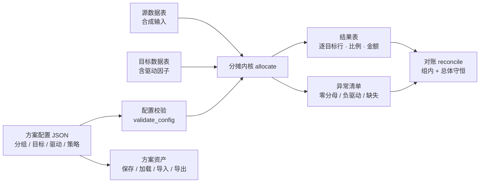

# 分摊框架设计（allocation_framework_design.md）

> 版本：allocation-engine-1 · 只作用于本地合成数据 · 不连接 TM1 Server。

## 1. 总体结构

## 2. 核心概念与配置项

| 配置项 | 含义 | 示例 |
|---|---|---|
| `group_dimensions` | 分组维度：组内独立分摊，组间不泄漏 | `["基地"]` |
| `allocation_dimensions` | 分配维度：分摊结果落到目标的维度 | `["品牌"]` |
| `value_field` | 源行金额字段 | `"费用"` |
| `driver_field` | 目标行驱动因子字段 | `"驱动"` |
| `write_policy` | `overwrite`（覆盖）/ `increment`（累加） | 仅记录语义，不执行写入 |
| `source_rows` / `target_rows` | 合成数据行 | JSON 数组 |

组键 = `group_dimensions` 在行上的取值组合。**只有同组的目标行参与该组源金额的分摊。**

## 3. 计算规则

1. **因子聚合**：同组目标行的驱动因子按行累加为组因子合计（重复目标坐标=多来源汇集）。
2. **比例**：`ratio = 目标因子 / 组因子合计`，Decimal 精确除法。
3. **金额**：`allocated = round_half_up(源金额 × ratio)`，**最后一行吸收尾差**：
   `allocated_last = 源金额 − Σ(前面各行)` → 组内总额精确守恒。
4. **幂等**：内核每次从源值完整重算；重复执行结果一致（config_hash 相同）。
   累加策略的"基准值管理"属调用方职责，内核不做二次累加。

## 4. 异常与边界行为

| 情形 | 行为 |
|---|---|
| 组因子合计 = 0 | 整组跳过，异常记录，金额计入"未分摊" |
| 组因子合计 < 0 | 整组跳过（负比例无业务含义），异常记录 |
| 个别目标因子 < 0 | 仍按比例分配（结果为负），异常提示人工确认 |
| 目标行缺因子 | 记 0 分摊，异常记录，不中断整组 |
| 组无目标行 | 金额未分摊，异常记录，对账显示缺口 |
| 源行金额不可解析 | 跳过该行，异常记录 |
| 配置校验失败 | 422 返回 errors，不执行计算 |

## 5. 对账（reconcile）

- 总体：`源合计 = 分配合计 ?`，不等时给出 `unallocated` 缺口。
- 分组：每组的守恒布尔 + 金额对照。
- 异常清单随对账一并返回，构成"结果 + 证明 + 待确认"三件套。

## 6. 方案资产与持久化

- 存储位置：`<data_dir>/allocation_schemes/<方案名>.json`（与模型数据库完全分离）。
- 方案名白名单：中文 / 字母 / 数字 / 下划线 / 连字符 / 空格，防路径穿越。
- 导出 JSON 与保存格式一致，可跨环境导入；`config_hash` 绑定配置内容。
- 与代码生成模板的关系：**不建第二套生成系统**；未来由现有 codegen 模块把方案渲染为 TI 骨架（未实现）。

## 7. API

| 端点 | 方法 | 说明 |
|---|---|---|
| `/api/allocation/run` | POST | 对请求体内合成数据执行分摊 + 对账 |
| `/api/allocation/schemes` | GET | 方案列表 |
| `/api/allocation/schemes/{name}` | GET / PUT / DELETE | 加载 / 保存 / 删除 |

## 8. 测试锚点（tests/test_allocation_engine.py · test_allocation_api.py）

两基地守恒、100/200/700→10万/20万/70万、组隔离、零分母、缺失驱动、负驱动、
尾差（100→33.33/33.33/33.34）、increment 记录、重跑幂等、配置哈希、
无效配置 422、方案 CRUD、路径穿越拒绝、页面可达。

## 9. 已知边界（与评估文档一致）

不执行 TI、不写 Cube/DuckDB、因子为手工输入、无条件写入配置、不声称与旧 BP 分摊等价。
